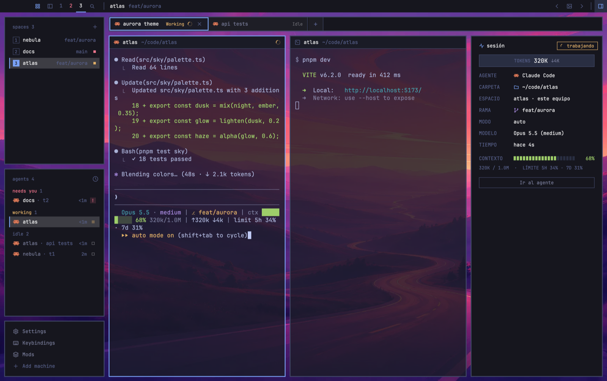

# Mosaico — un layout para Herdr

**El estilo de [Omarchy](https://github.com/shafiqimtiaz/herdr-omarchy), tu propia imagen de fondo detrás de las terminales y un panel con la sesión del agente que estás mirando.**



Mosaico junta tres ideas de la comunidad de [Herdr](https://herdr.dev):

| De | Qué toma |
| --- | --- |
| [herdr-omarchy](https://github.com/shafiqimtiaz/herdr-omarchy) | El look: mosaicos planos, cuadrados y con borde que flotan sobre el fondo, separados 10px; barra superior, espacios, agentes, pestañas, Files/Changes, uso de IA, paleta, ajustes y los 23 temas. |
| [frieren](https://github.com/CHO-kr/frieren) | Una imagen de fondo que se ve **a través de las terminales** (terminales translúcidas). |
| [herdr-arcade](https://github.com/PsyChaos/herdr-arcade) | Solo la información del panel **SESSION / NOW PLAYING**, rediseñada al estilo Omarchy. |

## Qué trae

- **Fondos que cambias cuando quieras.** El fondo es tuyo y ya no depende del tema. Con `⌘⌃W` / `⌘⌃⇧W` pasas al siguiente o al anterior, `⌘⌃R` elige uno al azar y `⌘⌃B` abre el selector. Las flechas `‹ ›` y el botón de imagen de la barra superior hacen lo mismo.
- **Selector de fondos**: miniaturas de tus fondos y de los del tema actual. Para añadir imágenes, **arrástralas** al selector o usa **Importar carpeta**. Ahí mismo ajustas:
  - **Terminales**: sólidas, 85, 70, 55, 40 o 25 % de opacidad (cuánto se ve el fondo).
  - **Cambiar cada**: nunca, 5, 15, 30 o 60 minutos, en orden o **aleatorio**.
  - **Incluir** los fondos del tema de Omarchy en la rotación.
- **Panel de sesión** (`⌘⌃S` o el botón de panel de la barra) del agente enfocado:
  - estado (trabajando, te necesita, terminó, en espera)
  - **tokens** (entrada ↓salida)
  - agente, carpeta, espacio · máquina y rama
  - modo de permisos (auto, plan…), modelo (esfuerzo) y tiempo
  - **contexto** libre en 20 bloques, con tokens usados/tamaño y los límites **5H · 7D** del plan
  - **Ir al agente**

## Instalar

Requisitos: [Herdr](https://herdr.dev) con `herdr-app` en el PATH, `git`, `python3`, y `jq` para la status line.

```sh
git clone https://github.com/<tu-usuario>/herdr-mosaico
cd herdr-mosaico
./install.sh
```

El instalador:

1. Instala **herdr-omarchy** si no lo tienes. Mosaico usa sus mods de barra lateral, pestañas, paneles, Git, uso de IA, paleta, ajustes y temas.
2. Copia `layouts/mosaico.json`, `mods/mosaico`, `mods/mosaico-session` y `backgrounds/mosaico/` a `~/.config/herdr-app`.
3. Añade la sección `layout:mosaico` a tu `keys.json`, sin reemplazar teclas que ya uses.
4. Ejecuta `herdr-app check` en cada mod y cambia al layout.

**No sobrescribe nada**: lo que ya existe se queda como está y el instalador te lo reporta. Para volver a tu layout usa `ctrl-shift-l`.

También puedes pedírselo a tu agente dentro de Herdr: *"Lee ~/.config/herdr-app/AGENTS.md y añade el layout de github.com/<tu-usuario>/herdr-mosaico"*.

> [!NOTE]
> Lo que corre en tu máquina:
> - `mosaico` ejecuta `ls`, `cp`, `find`, `mkdir` y `open`/`xdg-open` para listar, copiar y abrir fondos, y `herdr-app do layout.set` para cambiar el fondo y la opacidad.
> - `mosaico-session` ejecuta `hc read <terminal> --lines 0` (solo la pantalla visible, cada 4 s y solo mientras el panel está abierto). También lee `~/.cache/herdr-mosaico/sessions/*.json`.
> - Ninguno de los dos usa la red. Los mods de herdr-omarchy sí (lee [su README](https://github.com/shafiqimtiaz/herdr-omarchy#install)); por ejemplo, `omarchy-ai-usage` consulta el uso de cada proveedor con tus credenciales locales.

## Panel de sesión: modelo y tokens

El panel saca la información de dos fuentes:

- **Sin configurar nada**, lee el pie de Claude Code en pantalla: estado, carpeta, rama, modo, tiempo, % de contexto y los límites 5h / semana.
- **Para ver también modelo, esfuerzo, tokens y contexto usado/tamaño**, activa la status line incluida. Guarda el JSON de Claude por terminal en `~/.cache/herdr-mosaico/sessions/`.

```sh
cp extras/statusline.sh ~/.claude/statusline-mosaico.sh
jq '.statusLine={"type":"command","command":"~/.claude/statusline-mosaico.sh","padding":0}' \
  ~/.claude/settings.json > /tmp/s && mv /tmp/s ~/.claude/settings.json
```

¿Ya tienes una status line propia? Copia el bloque `if [ -n "$HC_TERMINAL_ID" ] …` del inicio de `extras/statusline.sh` al principio de la tuya.

## Teclas (macOS)

Funcionan solo en el layout Mosaico. En Linux o Windows, `install.sh` usa `keys.linux.json`, donde `⌘` se vuelve `super`.

| Tecla | Acción |
| --- | --- |
| `⌘⌃W` / `⌘⌃⇧W` | Fondo siguiente / anterior |
| `⌘⌃R` | Fondo al azar |
| `⌘⌃B` | Selector de fondos |
| `⌘⌃S` | Mostrar u ocultar el panel de sesión |
| `⌘⌃T` | Temas de Omarchy |
| `⌘⌃K` | Lista de teclas |
| `⌃⇧P` | Paleta de comandos |
| `⌘,` | Ajustes |
| `⌃⇧M` | Gestor de mods |
| `⌃⌥⇧T` | Reabrir la última pestaña cerrada |

## Personalizar

| Quiero cambiar | Dónde |
| --- | --- |
| Mis fondos | `~/.config/herdr-app/backgrounds/mosaico/` (o el botón **Abrir carpeta**) |
| Opacidad inicial de las terminales | `terminal_opacity` en `layouts/mosaico.json` |
| Ancho del panel de sesión | nodo `session` en `layouts/mosaico.json` (320px, de 260 a 520) |
| Colores | cualquier tema en `themes/` (`⌘⌃T`) |
| Fuente | `font` / `ui_font` en el layout (JetBrains Mono; Omarchy usa CaskaydiaMono Nerd Font) |

## Desarrollo

```sh
npm test                                   # pruebas del lector de sesión (Node, sin instalar nada)
herdr-app check mods/mosaico
herdr-app check mods/mosaico-session
```

Lo que editas aquí no cambia la copia instalada en `~/.config/herdr-app`: cópiala para verlo en Herdr. [`RECIPE.md`](RECIPE.md) describe cada parte para reconstruirla desde cero.

## Créditos y licencias

- Código de Mosaico: MIT ([LICENSE](LICENSE)).
- El look, los temas y los mods `omarchy-*` son de [shafiqimtiaz/herdr-omarchy](https://github.com/shafiqimtiaz/herdr-omarchy) y se instalan desde su repo. Los temas y fondos de Omarchy son MIT (© David Heinemeier Hansson).
- La idea de las terminales translúcidas sobre un fondo viene de [CHO-kr/frieren](https://github.com/CHO-kr/frieren). La imagen de Frieren **no se incluye** en este repo porque no es arte original. Si quieres usarla, descárgala de ese repo y ponla en `backgrounds/mosaico/frieren.jpg`.
- La información del panel de sesión se inspira en [PsyChaos/herdr-arcade](https://github.com/PsyChaos/herdr-arcade). El código de aquí es propio.
