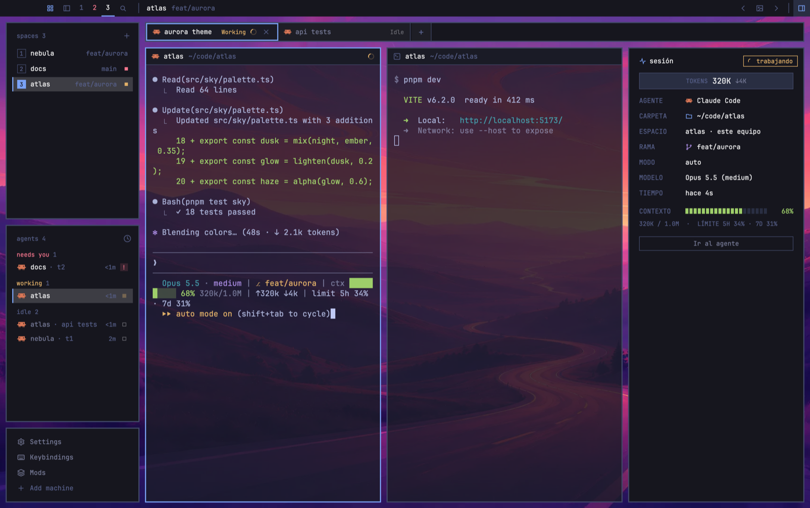

# Mosaico

Omarchy's flat, square, bordered tiles floating 10px apart over a wallpaper of your own, which also
shows through translucent terminals. The wallpaper is yours, not the theme's: change it with a key,
pick it from a thumbnail dialog, drop new pictures in, or let it rotate on a timer. A session tile
on the right shows the run of the agent you're looking at: status, tokens, agent, folder, space,
branch, permission mode, model, time and the context left with the plan's 5h / 7d limits.

## What you see

Sizes are logical px at zoom 1; colors are theme names (default theme `tokyo-night`).

- **Top bar**, 30px, `chrome`, drags the window (`titlebar: "none"`, macOS traffic lights at [12, 8]):
  - **Left** (`mosaico` role `left`, weight 3): 76px left on macOS for the window buttons; a 30px
    `accent` grid icon (palette), a sidebar toggle, the space numbers (active `foreground` with a
    2px `accent` underline, a space with a blocked agent in `blocked`, others `dim`), a search icon,
    `│`, the space name, the focused folder when it differs, the branch, `@machine`.
  - **AI usage** (`omarchy-ai-usage {compact: true}`, weight 2.5).
  - **Right** (`mosaico` role `right`, weight 3): 30px square buttons `‹` (previous wallpaper), an
    image icon (the picker), `›` (next), `│`, a panel icon lit (`accent` on `hover`) while the
    session tile shows, and minimize / maximize / close where the system draws no window buttons
    (close turns `blocked` on hover). Icons 14px, `dim`, `foreground` on hover.
- **Desk** row, 10px padding and gaps, the wallpaper (`background.image`, `cover`) between tiles:
  - **Sidebar** 243px (Omarchy's): Spaces, Agents and the footer as three `chrome` tiles with a 2px
    `border` frame.
  - **Work column**: Omarchy's 36px tab strip tile, then the work body row (10px gaps):
    - **Panes**: square, 2px `border` frame, 2px `accent` when focused, 30px `omarchy-pane` header,
      **no pane background**, and the root's `terminal_opacity` 0.55, so the wallpaper shows
      through every terminal.
    - Omarchy's hidden Files / Changes / notes panel (475px).
    - **Session tile** (`mosaico-session`, 320px, 260–520, `chrome`, 2px `border`), 10px top and side
      padding:
      - 26px header: a 13px `accent` activity icon, "sesión" in `foreground`, and at the right a 20px
        status chip with a 1px border and 11px text in the status color: a spinning 11px arc and
        "trabajando" (`working`), a filled 7px square and "te necesita" (`blocked`) or "terminó"
        (`done`), a hollow 7px square and "en espera" (`dim`).
      - **TOKENS** box, 30px, 1px `border` on `hover`: "TOKENS" 11px `dim`, the input tokens 14px
        semibold ("320K"), "↓4K" 11px `muted`. Only when known.
      - 22px rows, 76px `dim` label, `foreground` value or "—": AGENTE (program icon, its name),
        CARPETA (`accent` folder icon, the pane's live folder with `~`), ESPACIO ("space · machine"
        or "· este equipo"), RAMA (only when there is one; branch icon in `ansi5`), MODO (auto,
        aceptar ediciones, plan, sin permisos), MODELO ("Opus 5.5 (medium)"), TIEMPO ("hace 23s",
        "hace 4m 12s"; since it started working, else since its tab last changed).
      - **CONTEXTO**: 20 square 10px blocks 2px apart, lit to the percent of context left, in
        `done` above 50%, `working` above 20%, else `blocked`, unlit `hover`; the percent at the
        right in the same color; below in 11px `dim` "320K / 1.0M  ·  LÍMITE 5H 34% · 7D 31%".
      - A 26px "Ir al agente" button with a 1px `border`.
      - No agent: "Enfoca el panel de un agente para ver su sesión." in `dim`.
- **Wallpaper picker** (`mosaico` role `wallpapers`): an 820×640 dialog, `frame: "none"`, square,
  `chrome` with a 2px `accent` border.
  - 44px header: image icon, "Fondos", "N propios", **Abrir carpeta**, **Al azar**, a close button.
  - Controls rows with a 110px `dim` label and 24px square chips (selected: `accent` fill,
    `accent_foreground` text): Terminales (sólidas, 85%, 70%, 55%, 40%, 25%), Cambiar cada (nunca,
    5, 15, 30, 60 min, then "aleatorio"), Incluir ("fondos del tema <theme>").
  - A scrolling body: **Mis fondos** then **Tema · <theme>**, 176×99 thumbnails with a 2px
    frame (`accent` for the current one, `input` on hover), the file name under each (`● name` when
    current), and an **Importar carpeta** tile ("o arrastra imágenes aquí").
  - 30px footer: the folder path and "Esc cierra".

## How it behaves

- **Agent status** in the session tile, as above. Omarchy's tiles show it as Omarchy does.
- **Which agent the session tile shows**: the focused agent; else the newest (`seq`) in the
  focused tab; else in the focused space; else none.
- **Session data**, refreshed every 4 s only while the `session` node isn't hidden, one read at a
  time:
  1. `~/.cache/herdr-mosaico/sessions/<terminal>.json`, written by `extras/statusline.sh` (Claude
     Code's status-line JSON plus `mosaico_at`): model, effort, context size / used / left, total
     input and output tokens, 5h and 7d limits. Local agents only.
  2. `hc read <t> --lines 0` (the visible screen only): the permission mode
     (`(auto mode|accept edits|plan mode|bypass permissions) on`), and, when there's no JSON,
     either this layout's status line (`Opus 5.5 · medium | … | ctx ███░ 68% 320k/1.0M | ↑320k ↓4k |
     limit 5h 34% · 7d 31%`, also Arcade's `%68` and `5s`/`7g`) or Claude Code's own footer
     (`ctx ██░░ 22%   5h ██░░ 27% ↻ …   sem █░░ 12%`, where the percent is used, not left).
     JSON wins field by field.
- **Wallpapers**: the pool is `backgrounds/mosaico/*` (jpg, jpeg, png, webp, gif, bmp; sorted),
  plus `backgrounds/omarchy/<theme>/` when "Incluir" is on (shared `mosaico.theme_walls`). Next
  and previous wrap around; random never repeats the current one. A theme change doesn't touch the
  wallpaper.
- **Rotation**: shared `mosaico.rotate` (minutes, 0 off) and `mosaico.shuffle`. The left bar copy
  checks every 30 s and changes it once `mosaico.rotated_at` is that old. Any change resets the clock.
- **Adding pictures**: files dropped on the picker, or every picture directly in a folder chosen
  with **Importar carpeta** (`pickFolder`), are copied into `backgrounds/mosaico/` under a clean
  name, never over an existing file (`name-2.jpg`…), and the last one becomes the wallpaper. A toast
  says how many.
- **See-through**: a Terminales chip sets the root's `terminal_opacity`.
- Clicking a space number selects it, the grid opens `omarchy-palette`, search opens `picker`, the
  sidebar toggle folds the sidebar to 76px (macOS) / 44px and back (shared `sidebar.width`).
- **Keys** (`layout:mosaico`, macOS; `keys.linux.json` uses `super`): `cmd-ctrl-w` / `cmd-ctrl-shift-w`
  next / previous wallpaper, `cmd-ctrl-r` random, `cmd-ctrl-b` picker, `cmd-ctrl-s`
  `layout.toggle:session`, `cmd-ctrl-t` Omarchy themes, `cmd-ctrl-k` keys list, `ctrl-shift-p`
  palette, `cmd-,` settings, `ctrl-shift-m` mod manager, `ctrl-alt-shift-t` reopen closed tab.

## Built from

- **Depends on** [herdr-omarchy](https://github.com/shafiqimtiaz/herdr-omarchy): mods
  `omarchy-spaces`, `omarchy-agents`, `omarchy-chrome`, `omarchy-tabs`, `omarchy-pane`,
  `omarchy-files`, `omarchy-changes`, `omarchy-notes`, `omarchy-ai-usage` in the layout, and
  `omarchy-palette`, `omarchy-settings`, `omarchy-themes`, `omarchy-keys`, `omarchy-mod-manager`
  from keys; its `themes/` and `backgrounds/omarchy/`. Not `omarchy-bar`: it ties the wallpaper to
  the theme.
- **Layout** `layouts/mosaico.json`: Omarchy's tree with root `background.image`
  `backgrounds/mosaico/frieren.jpg`, `terminal_opacity` 0.55, `font`/`ui_font` JetBrains Mono,
  `preview` `layouts/mosaico.svg`; `bar-left` / `bar-right` → `mosaico {role}`; the `main` pane frame
  without `background`; a `session` block appended to `work-body`.
- **`mods/mosaico`** (`main.js` roles, `wallpaper.js`, 13 stroke icons). `wallpaper.js` lists
  folders with `ls` (PowerShell on Windows), copies with `cp`, finds a folder's pictures with
  `find -maxdepth 1`, opens the folder with `open` / `xdg-open` / `explorer`, and changes the
  root through `exec("herdr-app", ["do", "layout.set", …])`, because `run()` refuses arguments
  nested deeper than 16 levels. The picker opens with `openOverlay({ mod: "mosaico", kind:
  "dialog", frame: "none", width: 820, height: 640, props: { role: "wallpapers" } })`. Commands
  (`nextCommand`, left copy only): `next-wallpaper`, `prev-wallpaper`, `random-wallpaper`,
  `wallpapers`.
- **`mods/mosaico-session`** (`main.js`, `parse.js` with the pure parsers, 4 icons). Uses
  `agents`, `spaces`, `panes`, `focused`, `theme`, `home`, `hc`, `readTextFile`, `layout`, `run`
  (`agent.focus`).
- **`extras/statusline.sh`** (bash + jq): prints the status line above and, when
  `HC_TERMINAL_ID` is set, writes the JSON atomically (`.tmp` then `mv`).
- **`install.sh`**: installs herdr-omarchy when missing, copies without overwriting, writes each
  new mod's `mod.json` as `{"place":"none"}` first (Omarchy's Files and Changes ask for `right`
  and would dock into the shown layout), merges keys, checks every mod, switches.

## Watch out

- **Images are cached by path.** A replaced file keeps showing the old picture until Herdr
  restarts, which is why imports never overwrite and always pick a new name.
- **Thumbnails stretch** to 16:9 (GPUI has no object-fit here). The wallpaper itself is `cover`.
- **The Frieren picture isn't redistributable** (fan art via CHO-kr/frieren). It's git-ignored;
  without it `install.sh` starts the layout on Omarchy's Tokyo Night `1-winding-road.webp`.
- **`hc read` with history stalls the core** on long sessions: keep `--lines 0`, never overlap
  reads, and skip them while the tile is hidden.
- **Model and tokens need the status line.** Claude Code's own footer only gives context % and
  limits. The JSON is per terminal on this machine; agents on other machines get only the screen.
- **Week label** in Claude's footer follows its language (`sem`, `week`…); the parser knows a few.
- **`keys.json`**: merging marks the file as yours, so Herdr stops adding new default keys to it.
- The picker's sections and rows assume an 820px dialog; the session tile truncates below ~260px.

## Done when

- `npm test` passes; `herdr-app check` passes for `mods/mosaico` and `mods/mosaico-session`;
  `herdr-app status` shows `"layout": "mosaico"` and `"errors": []`.
- The wallpaper shows between every tile and through the terminals; `cmd-ctrl-w` changes it,
  and changing the theme with `cmd-ctrl-t` leaves it alone.
- `cmd-ctrl-b` opens the picker; dropping a .jpg adds a thumbnail and makes it the wallpaper; the
  55% chip changes how much shows through; "5 min" changes it five minutes later.
- With Claude Code focused, the session tile shows "trabajando" with a spinner while it works, the
  folder, space, mode, time and a context bar with 5H / 7D limits; with `extras/statusline.sh`
  installed, also TOKENS and MODELO.
- `cmd-ctrl-s` hides and shows the session tile; "Ir al agente" focuses its pane.
